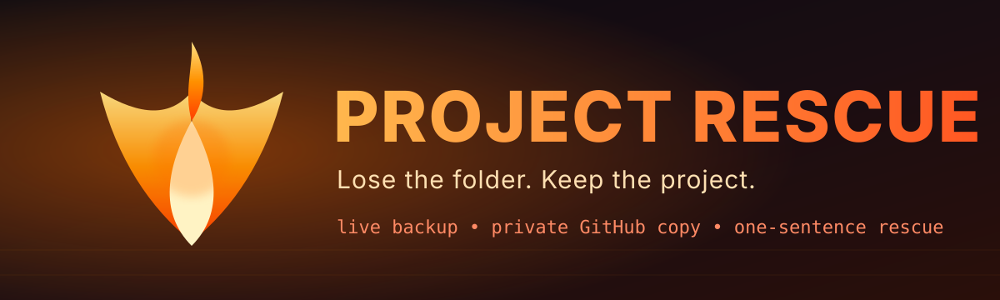
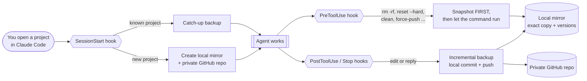
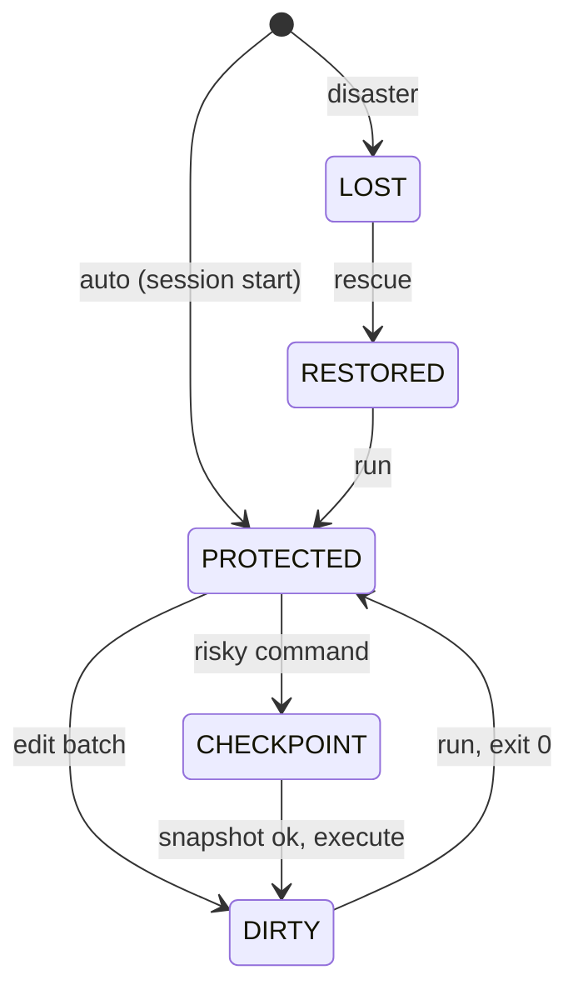

<div align="center">



<br>

### 🛟 Lose your project folder. Lose nothing.

**Project Rescue** quietly protects *every* project you open with an AI coding agent:
an exact local mirror, a private GitHub copy, and a one-sentence rescue when disaster strikes.

<br>

[](https://github.com/itzmoksh01/project-rescue/actions)


[**Install in 60 seconds**](#-install-in-60-seconds) ·
[**How it works**](#-how-it-works) ·
[**Rescue**](#-rescue-the-one-sentence-recovery) ·
[**Safety design**](#-built-to-never-make-things-worse) ·
[**FAQ**](#-faq)

</div>

---

## ✨ Why Project Rescue?

You are deep in a project with an AI agent. One wrong `rm -rf`, a dead SSD, a bad `git reset --hard`, a synced-folder accident, and weeks of work are gone.

Normal backups need **you** to remember them. Project Rescue needs **nothing** from you after a one-time install:

| | |
|---|---|
| 🧠 **Agents just know** | One install teaches Claude Code (and Codex / Gemini CLI) the standing orders for **every** project, forever. |
| 🔁 **Live, not nightly** | Backs up at session start, after file edits, after every reply, and **before any destructive command**. |
| 🏦 **Two safe places** | Exact local mirror **+** private GitHub repo, one per project, created automatically. |
| 🕰️ **Every version kept** | Each backup is a commit. Roll back to any earlier state, even after files were deleted. |
| 🔐 **Secrets stay home** | `.env`, keys and tokens live in the local mirror only. They are never pushed. |
| 🛟 **One-sentence rescue** | Say *"rescue my project"* (or `/rescue`) and it comes back: files, git history, branches, uncommitted work. |
| 🪶 **Zero dependencies** | One Python file. Needs only `git`. |

---

## 🚀 Install in 60 seconds

```bash
# 1. get it
git clone https://github.com/itzmoksh01/project-rescue.git
python3 project-rescue/project_rescue.py install

# 2. tell it who you are on GitHub (once)
python3 ~/.project-rescue/project_rescue.py connect --github YOUR_GITHUB_USERNAME
gh auth login            # once, so it can create PRIVATE repos for you
```

Or, after the repo is public, the one-liner:

```bash
curl -fsSL https://raw.githubusercontent.com/itzmoksh01/project-rescue/main/install.sh | sh
```

**That's the whole setup.** Open a **new** Claude Code session in any project. It protects itself.

> `gh` is the [GitHub CLI](https://cli.github.com). Skip it and Project Rescue still works, local-only, and tells you so.

---

## 🧬 How it works



**Two layers make agents reliable:**

1. **Hooks (deterministic).** Claude Code runs Project Rescue automatically on session start, after edits, after replies and before risky shell commands. No reliance on the model remembering.
2. **Standing orders (cognitive).** A compact protocol is written into `~/.claude/CLAUDE.md` (and `AGENTS.md` / `GEMINI.md` for Codex / Gemini CLI if installed) so the agent understands *why*, reports honestly, and never takes shortcuts. See [docs/AGENT_PROTOCOL.md](docs/AGENT_PROTOCOL.md).

### The state graph every agent follows



---

## 🛟 Rescue: the one-sentence recovery

Folder deleted? Disk died? New laptop? Open your agent **anywhere** and type:

```
rescue my project
```

or the slash command `/rescue`, or in a terminal `project-rescue rescue`. Real output from a test run:

```text
$ project-rescue rescue
RESCUED -> /work/shop-app
  from: local backup (~/ProjectRescue/shop-app)
  files: 3
  dependencies were not backed up (they are re-creatable). Run: npm install
```

| Situation | What Project Rescue does |
|---|---|
| Local backup still exists | Restores from it, **including `.env`**, then resumes backups |
| Local backup gone (new machine) | Downloads your private repo, restores, re-registers, resumes backups |
| Folder still has files | Restores **beside** it (`name-restored-<time>`), **never overwrites** |
| Need an older state | `project-rescue restore --list` then `--rev <id>` |

Restored: every file, symlinks, your **git history, branches, tags, remotes and uncommitted changes**.

---

## 🛡️ Built to never make things worse

- **Safety stop.** If a huge share of backed-up files suddenly vanish from the project (accidental delete, unplugged drive), the backup **refuses to run** so your good copy is not overwritten. Override needs an explicit `--force`.
- **Pre-flight snapshots.** Before `rm -rf`, `git reset --hard`, `git clean`, force-push and friends, Project Rescue snapshots first.
- **Secrets never reach GitHub.** `.env*`, `*.pem`, `*.key`, SSH keys, `.npmrc`, `credentials.json`, `*.tfstate` and more stay in the local mirror only. `.env.example` is allowed.
- **Private only.** It creates private repos and **refuses to push to a public one**.
- **Won't protect the wrong thing.** Never your whole home folder, `Documents`, system folders or its own backups. Projects over 3 GB / 150k files are skipped with a clear message. Opt a project out with `project-rescue off`.
- **Hooks can't hurt you.** Hook entry points always exit 0, run in the background and log errors instead of blocking your agent.
- **Your config is respected.** Install merges into existing `settings.json` / `CLAUDE.md`, keeps a `.rescue-bak`, refuses to touch invalid JSON, and `uninstall` removes only its own parts.
- **Self-healing.** Lost the local backup folder but GitHub is fine? It is rebuilt from GitHub automatically and history continues. Logged in to `gh` later? The private repo is attached automatically at your next session.
- **Loud when it matters.** If the safety stop pauses backups, the agent is told at the start of the next session so it warns you instead of staying silent.
- **Crash-safe.** Atomic file copies, lock file with re-run queue, per-file error isolation.

---

## 🧰 Commands

| Command | What it does |
|---|---|
| `project-rescue install` / `uninstall` | Wire into (or remove from) Claude Code, Codex, Gemini CLI |
| `project-rescue connect --github USER` | One-time GitHub link for auto-created private repos |
| `project-rescue auto` | Protect the current project now |
| `project-rescue run` | Back up now (`--dry-run`, `--force`) |
| `project-rescue status` / `list` | Proof that everything is in sync / all protected projects |
| `project-rescue rescue [name]` | Bring a lost project back |
| `project-rescue restore --list` | Browse versions; `--source`, `--rev`, `--to` for surgical restores |
| `project-rescue off` / `on` | Opt a project out / back in |
| `project-rescue watch` | Foreground watcher for any editor |
| `project-rescue hook git` | Also back up on every git commit |
| `project-rescue init` | Manual setup: custom backup folder, repo, `--exact`, `--exclude` |

Everyday use needs none of these. They exist for control and debugging.

---

## 📦 What is backed up

Everything in the project folder (files, symlinks, empty folders locally) **except** regenerable clutter: `node_modules`, `.venv`, `venv`, `__pycache__`, caches, `.DS_Store`. Use `project-rescue init --exact` to copy literally everything. Your project's `.git` history is preserved as a bundle.

**Known limits (we say them out loud):** nested `.git` folders / submodules are not copied; empty folders are not in GitHub restores; stashes are best effort; Windows support is experimental\*.

---

## 🤖 Agent support

| Agent | Level |
|---|---|
| **Claude Code** | ✅ Full automation: hooks + standing orders + `/rescue` and `/vault` |
| **Codex CLI**, **Gemini CLI** | 🟡 Standing orders in `AGENTS.md` / `GEMINI.md` (agent runs the commands itself) |
| Cursor, Windsurf, Aider, others | 🟡 Paste the block from [docs/AGENT_PROTOCOL.md](docs/AGENT_PROTOCOL.md) into your rules file |

---

## ❓ FAQ

<details><summary><b>Does it slow my agent down?</b></summary>
Backups run in the background and are incremental (only changed files). The only synchronous step is the pre-flight snapshot before a destructive command.
</details>

<details><summary><b>Will it spam my GitHub with repos?</b></summary>
One private repo per project, named <code>&lt;project&gt;-rescue-backup</code>, only after you run <code>connect</code>. Not connected means local-only. <code>project-rescue off</code> opts a project out.
</details>

<details><summary><b>Is my code safe on GitHub?</b></summary>
It only ever pushes to <b>private</b> repos and refuses public ones. Secret-looking files are excluded. Treat the repo like your private source code: it is. See <a href="SECURITY.md">SECURITY.md</a>.
</details>

<details><summary><b>What if I delete the backup folder too?</b></summary>
That is what the GitHub copy is for: <code>project-rescue rescue NAME --github YOUR_USERNAME</code> works on a brand-new machine. For extra safety put the backup folder on another drive: <code>project-rescue connect --backup-root /Volumes/Other/ProjectRescue</code>.
</details>

<details><summary><b>Can I remove it?</b></summary>
<code>project-rescue uninstall</code> removes hooks, orders and commands. Your backups are never deleted.
</details>

---

## 🗺️ Roadmap

- Native Windows hardening and CI
- Optional encryption at rest for the local mirror
- Cursor / Windsurf auto-installers
- `project-rescue doctor` self-diagnosis

## 🤝 Contributing

PRs welcome. Run the suite with `python3 -m unittest discover -s tests -v` (15 end-to-end scenarios, no network). See [CONTRIBUTING.md](CONTRIBUTING.md) and [docs/ARCHITECTURE.md](docs/ARCHITECTURE.md).

<div align="center">

**MIT licensed** · Built so that *"I lost everything"* stops being a sentence you ever say.

🛟 *If Project Rescue saves your day, a ⭐ helps others find it.*

</div>
