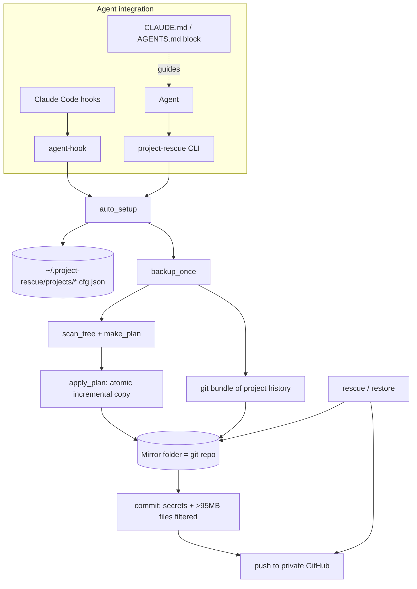

# Architecture

One file (`project_rescue.py`), standard library only, plus `git`.

## Backup pipeline (`backup_once`)

1. **Scan** project and mirror; compute a plan (add / update / delete). Mtime tolerance 20 ms; symlinks preserved.
2. **Guard.** Abort if the plan would delete more than 30% (and at least 5) of backed-up files, or the project is empty.
3. **Apply** with atomic temp-file + rename copies. Per-file errors are collected, not fatal.
4. **Manifest + bundle.** `.rescue-manifest.json` (origin path, remotes, HEAD) and `.rescue-git.bundle` (rebuilt only when refs change).
5. **Commit** with `add -A -f` (project `.gitignore` files are deliberately overridden for a faithful copy), then un-stage secrets and files over 95 MB so they never reach GitHub.
6. **Push** to `origin` (`HEAD:main`), checking first that the repo is private when `gh` is available. Failure leaves `pending_push` set and is retried next run.

## Concurrency

A lock file per project (stale after 30 min or dead PID). A run requested while another is active leaves a re-run flag, so the final edits are never missed.

## Rescue

`rescue_known`: local mirror first, else the GitHub remote from config. `rescue_github`: fresh machine, clones the vault repo, restores, registers a new config pointing at the clone so history continues. Both restore into an empty target or a `-restored-<time>` sibling, never over existing files. History is rebuilt from the bundle (`fetch --update-head-ok`, then HEAD and index are reset to match).

## Files on disk

| Path | Purpose |
|---|---|
| `~/.project-rescue/project_rescue.py` | Installed engine (hooks call this) |
| `~/.project-rescue/config.json` | GitHub user, backup root, opted-out projects |
| `~/.project-rescue/projects/<slug>.cfg.json` / `.state.json` | Per-project config and state |
| `~/ProjectRescue/<project>/` | Local mirror (also a git repo) |
